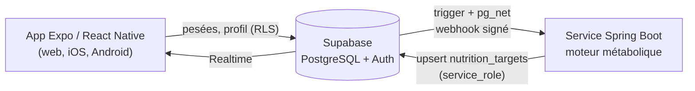

# Adaptatic

Une application de nutrition qui **recalcule automatiquement tes objectifs en fonction de ta progression réelle**, au lieu de te donner un chiffre figé.

Tu entres ton profil et ta pesée du jour. Un service de calcul détermine tes calories et macros, lisse ton poids pour ignorer le bruit quotidien (eau, sel, digestion), mesure ta vraie vitesse de progression, puis corrige tes calories si tu t'écartes de ton objectif.


## Architecture



Le calcul est **événementiel** : une pesée ou un changement de profil déclenche un trigger PostgreSQL qui prévient le service Java par webhook. L'app n'a rien à appeler : elle reçoit le nouvel objectif en temps réel.

| Dossier | Contenu |
|---|---|
| `supabase/` | Schéma SQL, politiques RLS, triggers de webhook |
| `service/` | Java 21, Spring Boot 3, moteur métabolique pur + tests JUnit |
| `app/` | Expo, React Native, TypeScript (inscription, profil, pesées, tableau de bord) |
| `docs/` | [Algorithme et sources](docs/algorithm.md) · [Installation](docs/setup.md) |

## Choix de conception

- **Moteur pur et testable** : le calcul (`service/.../engine`) n'a aucune dépendance Spring ; l'horloge est injectée, donc chaque scénario (période d'observation, délai entre deux ajustements, bornes) est testé de façon déterministe.
- **Sécurité par défaut** : RLS sur toutes les tables, l'utilisateur ne peut pas écrire ses propres objectifs, le webhook est authentifié par un secret comparé en temps constant, la clé `service_role` n'existe que côté serveur.
- **Garde-fous** : rythme de perte plafonné à 1 %/semaine, de prise à 0,5 %/semaine, plancher calorique, correction limitée par pas et au total.
- **Honnêteté du modèle** : l'ajustement ne démarre qu'après 14 jours de suivi et seulement avec assez de pesées ; sinon l'app l'explique à l'utilisateur plutôt que d'inventer un chiffre.

## Statut

| Fonctionnalité | État |
|---|---|
| Profil, pesées quotidiennes, objectifs calories/macros | ✅ MVP |
| Tendance de poids lissée, vitesse sur 14 jours | ✅ MVP |
| Correction adaptative des calories | ✅ MVP |
| Tests automatisés (Java) et CI | ✅ |
| Dates locales (fuseau de l'utilisateur) et nouveau design sombre à 4 onglets | 🚧 en cours (PR `feat/foundations`) |
| Journal alimentaire : aliments par 100 g, repas, macros, eau, ajout rapide | 🚧 en cours (PR `feat/food-journal`) |
| Scan de code-barres (Open Food Facts) | ✅ fait, testé en réel (saisie manuelle, web) — scan caméra non testé sur appareil |
| Recettes, repas favoris | 🔜 prévu |
| **Replanification face aux imprévus** (repas à l'extérieur, écart, voyage) | 🔜 v2, voir ci-dessous |
| Notifications, graphique de progression | 🔜 prévu |

### Prochaine étape : les imprévus

L'idée de la v2 : quand l'utilisateur déclare un événement (restaurant ce soir, week-end chargé), le moteur **répartit** l'écart sur les jours suivants dans les bornes de sécurité plutôt que de "punir" un seul jour. Le modèle de données et le moteur actuels (calories cibles + offset persisté) ont été conçus pour accueillir cette extension.

## Démarrage rapide

Voir [docs/setup.md](docs/setup.md) (création du projet Supabase, variables d'environnement, lancement du service et de l'app).

```bash
# Service : tests
cd service && mvn verify

# App
cd app && npm install && npm run web
```

> Outil d'aide au suivi, pas un avis médical. En cas de pathologie, de grossesse ou de trouble alimentaire, consulte un professionnel de santé.
